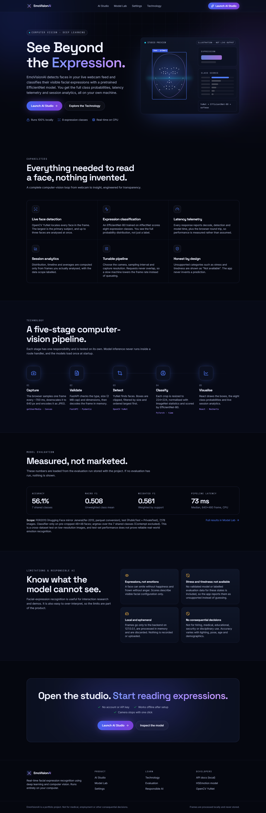
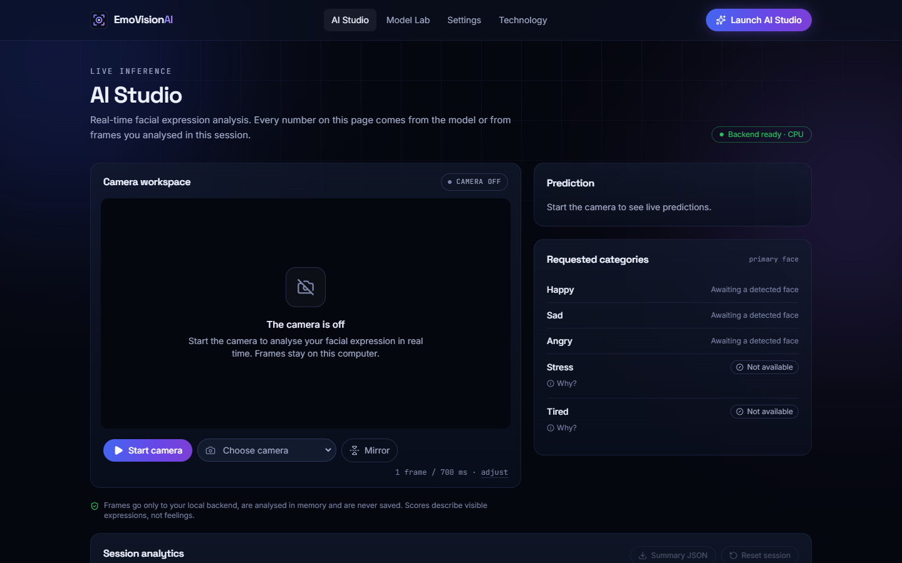
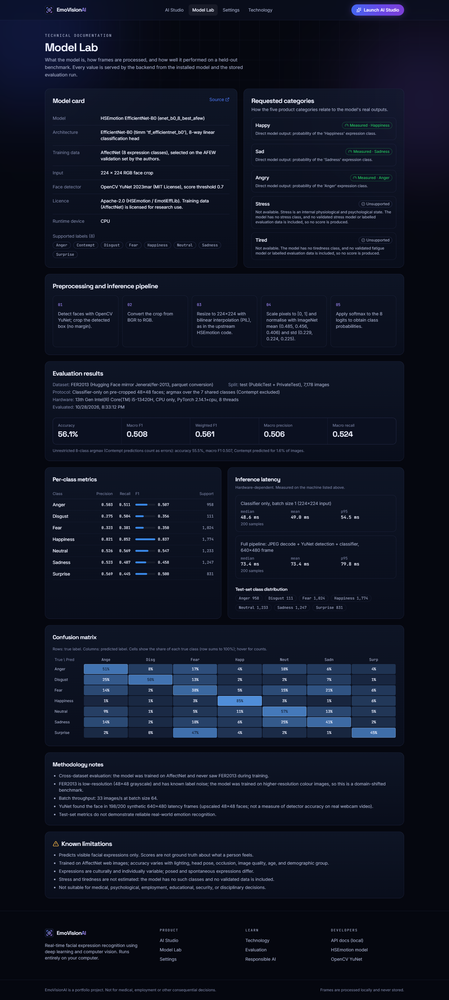
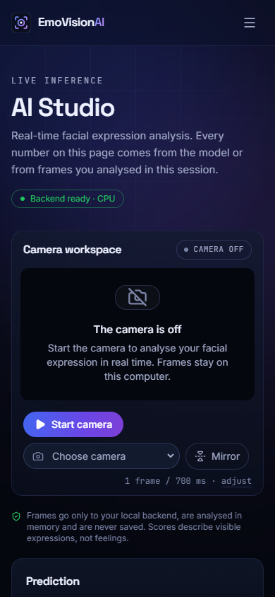
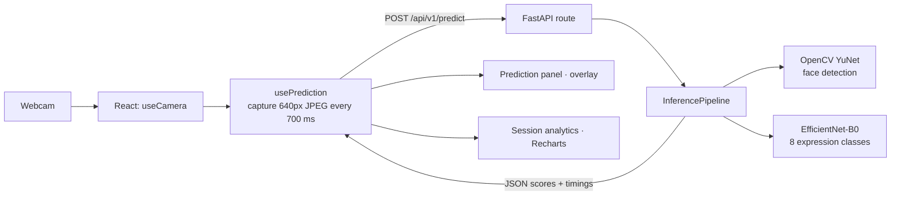

# EmoVisionAI

**Real-time facial expression recognition using deep learning and computer vision. It runs entirely on your own computer.**

EmoVisionAI reads your webcam in the browser, sends sampled frames to a local FastAPI service, detects faces with OpenCV YuNet, and classifies each face's visible expression with a pretrained EfficientNet-B0. You see the top expression, all eight class probabilities, per-stage latency, and live session analytics.

The project emphasises honest ML engineering. It shows only measured numbers, reports unsupported categories as unsupported, loads model weights safely, and documents its limitations.



| AI Studio | Model Lab | Mobile |
| --- | --- | --- |
|  |  |  |

> The screenshots were captured with a headless browser and a synthetic camera. Screenshots of live predictions on a real face are not included, to avoid publishing anyone's face.

---

## Features

- **Live AI Studio.** Start or stop the camera, choose a device, and mirror the preview. Face boxes are drawn with labels. The panel handles permission denial, missing cameras, unsupported browsers, no-face frames and multiple faces.
- **Prediction panel.** Shows the top expression, its probability, all 8 class scores, the timestamp, and model, server and round-trip latency.
- **Requested categories.** Happy, Sad and Angry map directly to model outputs. **Stress and Tired are shown as "Not available"** because no validated model or data supports them.
- **Session analytics.** Frame counts, no-face frames, session span, average latency, an expression-distribution chart, a Happy/Sad/Angry timeline, and a JSON summary export. Everything is computed only from real responses and kept in memory only.
- **Model Lab.** Model card, preprocessing pipeline, measured evaluation (accuracy, macro and weighted F1, per-class metrics, confusion matrix, latency), and limitations. It shows "Not evaluated yet" until an evaluation has run.
- **Settings.** Preferred camera, sampling interval, capture width, display toggles, session reset, clearing saved preferences, and a privacy notice.
- **Engineering.** Typed API contract, consistent error envelope, input limits, narrow CORS, non-overlapping requests with exponential backoff, models loaded once, and safetensors-only weight loading.

## Architecture



The module-level design and its decisions are in [docs/architecture.md](docs/architecture.md).

## Technology stack

| Layer | Technology |
| --- | --- |
| Frontend | React 19, TypeScript 6, Vite 8, Tailwind CSS 4, React Router 7, Recharts 3, lucide-react |
| Backend | Python 3.10, FastAPI, Pydantic 2, Uvicorn |
| Computer vision / ML | OpenCV 5 (YuNet), PyTorch 2.14 (CPU), timm, NumPy, Pillow, safetensors |
| Evaluation | scikit-learn, pandas, Hugging Face Hub |
| Testing / quality | pytest, HTTPX TestClient, Vitest, React Testing Library, ESLint, Ruff, Prettier |

## Project structure

```
EmoVisionAi/
├─ backend/
│  ├─ app/
│  │  ├─ api/v1.py            # HTTP routes (thin)
│  │  ├─ core/                # settings, error envelope
│  │  ├─ ml/                  # YuNet detector, EfficientNet classifier, labels
│  │  ├─ schemas/api.py       # Pydantic API contract
│  │  ├─ services/            # inference pipeline, image validation, model info
│  │  └─ main.py              # app factory + lifespan model loading
│  ├─ tests/                  # unit tests (fakes) + real-model smoke tests
│  ├─ requirements.txt / requirements-dev.txt
│  └─ .env.example
├─ frontend/
│  ├─ src/{pages,components,hooks,context,services,charts,types,styles,test}
│  └─ .env.example
├─ models/                    # weights (downloaded, git-ignored)
├─ evaluation/                # prepare_dataset.py, evaluate.py, results/metrics.json
├─ scripts/                   # setup_models.py, inspect_checkpoint.py
└─ docs/                      # architecture, design system, model card, evaluation
```

## Local setup (Windows, PowerShell)

### 1. Prerequisites

| Tool | Version used and verified |
| --- | --- |
| Python | 3.10.11 (64-bit). `requires-python` allows 3.10–3.12, but only 3.10 was tested. |
| Node.js | 22.17.1 (Vite 8 needs 20.19+ or 22.12+) |
| npm | 10.9.2 |
| Browser | Recent Chrome or Edge (camera access works on `localhost` / `127.0.0.1`) |
| GPU | Not required. CUDA is used automatically if a CUDA build of PyTorch and a GPU are present. |

### 2. Backend

From the repository root:

```powershell
py -3.10 -m venv backend\.venv
backend\.venv\Scripts\python.exe -m pip install --upgrade pip
# CPU build of PyTorch first (avoids pulling CUDA wheels)
backend\.venv\Scripts\python.exe -m pip install torch==2.14.1 --index-url https://download.pytorch.org/whl/cpu
backend\.venv\Scripts\python.exe -m pip install -r backend\requirements-dev.txt
```

### 3. Model weights (one-time, needs internet)

```powershell
backend\.venv\Scripts\python.exe scripts\setup_models.py
```

This step downloads the HSEmotion checkpoint (16 MB) and the YuNet detector (0.2 MB) and verifies their SHA-256 hashes. It then converts the checkpoint to `models/enet_b0_8_best_afew.safetensors`. After this, inference works **offline**.

### 4. Frontend

```powershell
cd frontend
npm install
copy .env.example .env   # optional; the default API URL is http://127.0.0.1:8000
cd ..
```

### 5. Run (two terminals)

**Terminal 1: FastAPI backend**

```powershell
cd backend
.venv\Scripts\python.exe -m uvicorn app.main:app --host 127.0.0.1 --port 8000
```

Wait for `Models loaded on cpu` and `Uvicorn running on http://127.0.0.1:8000`. The first start takes about 15 s while PyTorch loads.

**Terminal 2: React/Vite frontend**

```powershell
cd frontend
npm run dev
```

**Browser:** open the address Vite prints, which is `http://127.0.0.1:5173/`. Go to **AI Studio**, then **Start camera**, and allow camera access.

Ports 8000 and 5173 were verified free and used during development. Vite runs with `strictPort`, so it fails instead of silently switching ports, because the backend's CORS allow-list only includes ports 5173 and 4173.

### 6. Tests and quality checks

```powershell
# Backend: 30 tests (unit + real-model smoke tests)
cd backend
.venv\Scripts\python.exe -m pytest
.venv\Scripts\python.exe -m ruff check . ..\scripts ..\evaluation
.venv\Scripts\python.exe -m pytest -m "not model"     # fast unit tests only
cd ..

# Frontend: 42 tests
cd frontend
npm test
npm run typecheck
npm run lint
npm run build
cd ..
```

### 7. Evaluation (optional, needs internet once)

```powershell
backend\.venv\Scripts\python.exe evaluation\prepare_dataset.py   # FER2013 test split, 7,178 images
backend\.venv\Scripts\python.exe evaluation\evaluate.py          # writes evaluation/results/metrics.json
```

## API

Interactive docs are at **http://127.0.0.1:8000/docs** while the backend runs.

| Method | Path | Purpose |
| --- | --- | --- |
| GET | `/api/v1/health` | `ok` or `degraded`, model loaded, device, uptime |
| GET | `/api/v1/model/info` | Model card, labels, preprocessing, category mapping, evaluation summary or `null` |
| GET | `/api/v1/session/config` | Recommended interval, capture width, upload limit, accepted types |
| POST | `/api/v1/predict` | `multipart/form-data` with field `image` (JPEG/PNG/WebP, ≤ 2 MB, ≤ 4096 px) |

Example:

```powershell
curl.exe -F "image=@face.jpg;type=image/jpeg" http://127.0.0.1:8000/api/v1/predict
```

Response shape (abridged, illustrative values):

```json
{
  "success": true,
  "face_detected": true,
  "face_count": 1,
  "faces": [{ "box": { "x": 0.31, "y": 0.18, "width": 0.29, "height": 0.47 }, "is_primary": true, "...": "..." }],
  "predicted_expression": "Surprise",
  "confidence": 0.774,
  "class_scores": { "Anger": 0.002, "Contempt": 0.0, "...": "...", "Surprise": 0.774 },
  "requested_categories": [
    { "name": "Happy", "status": "measured", "score": 0.106, "model_label": "Happiness" },
    { "name": "Stress", "status": "unsupported", "score": null, "model_label": null }
  ],
  "unsupported_categories": [{ "name": "Stress", "reason": "Not available. ..." }],
  "inference_time_ms": 75.0,
  "timings": { "decode_ms": 2.1, "detection_ms": 21.4, "classification_ms": 75.0, "total_ms": 101.2 },
  "model_name": "HSEmotion EfficientNet-B0 (enet_b0_8_best_afew)",
  "timestamp": "2026-10-28T15:29:50Z",
  "message": null
}
```

Errors always use `{"success": false, "error": {"code": "...", "message": "..."}}`. Codes are `invalid_image` (422), `validation_error` (422), `unsupported_media_type` (415), `payload_too_large` and `image_too_large` (413), `model_unavailable` and `server_busy` (503), and `detection_failed`, `inference_failed` and `internal_error` (500). Stack traces and paths are never returned.

## Model

**HSEmotion `enet_b0_8_best_afew`**, an EfficientNet-B0 trained on AffectNet. It has 8 classes: Anger, Contempt, Disgust, Fear, Happiness, Neutral, Sadness, Surprise. The code is Apache-2.0, and faces are detected by **OpenCV YuNet** (MIT). Preprocessing reproduces the upstream code exactly. Details, intended use and risks are in [docs/model-card.md](docs/model-card.md).

**Safe weight loading.** The upstream file is a pickled PyTorch module, and unpickling can execute code. The setup script first lists the pickle's referenced classes statically without executing it. It then loads the file with `torch.load(weights_only=True)` and an explicit allow-list of those layer classes, verifies the rebuilt architecture layer by layer, and saves plain tensors as safetensors. The server only ever loads the safetensors file.

## Evaluation results

These are measured on the FER2013 test split (7,178 images) as a cross-dataset test, classifier-only, over the 7 classes shared with FER2013, on an Intel Core i5-13420H CPU.

| Accuracy | Macro F1 | Weighted F1 | Classifier latency (median) | Full pipeline latency (median) |
| --- | --- | --- | --- | --- |
| 56.1% | 0.508 | 0.561 | 48.6 ms | 73.4 ms |

Happiness is recognised well (F1 0.84). Fear, Disgust and Sadness are weak (F1 0.35–0.46), and Surprise is often confused with Fear. Methodology, per-class metrics and the confusion matrix are in [docs/evaluation.md](docs/evaluation.md). **These test-set numbers do not show that the model reliably recognises emotions in the real world.**

## Privacy and responsible AI

- Inference runs on your computer. Frames go only from the browser to `127.0.0.1:8000`.
- Frames are processed in memory and discarded. No images, recordings or raw frames are stored or logged.
- Session analytics stay in browser memory. Only display preferences are saved, in `localStorage`.
- The camera stops with one click and is released when you leave the Studio.
- Scores describe **visible facial expressions**, not feelings. **Do not use EmoVisionAI for employment, medical, educational, security, disciplinary or any other consequential decision.**

## Known limitations

- Stress and tiredness are not supported. No validated model or labelled data was available, so the app does not guess.
- Accuracy depends on lighting, pose, occlusion, camera quality and subject demographics. Demographic performance gaps were not measured.
- The evaluation dataset is low-resolution and differs from webcam conditions.
- Softmax confidences are not calibrated probabilities.
- CPU latency is about 75 ms per frame on the test machine and will differ on other hardware.

## Troubleshooting

| Symptom | Fix |
| --- | --- |
| Studio shows **Backend offline** | Start Terminal 1. Check `http://127.0.0.1:8000/api/v1/health`. |
| Health says **degraded / model not loaded** | Run `scripts\setup_models.py`, then restart the backend. |
| **Permission denied** | Allow the camera in the browser's site settings (lock icon in the address bar), then press *Try again*. |
| **Camera could not be started** | Close other apps that use the webcam (Teams, Zoom, Camera). |
| Browser console shows a CORS error | Open the app at `http://127.0.0.1:5173` or `http://localhost:5173`. Other ports are not on the allow-list. |
| `npm run dev` says port 5173 is in use | Stop the other process: `Get-NetTCPConnection -LocalPort 5173` shows its PID. |
| `py -3.10` not found | Install Python 3.10 from python.org, or use any 3.10–3.12 interpreter. |
| Slow predictions | Raise the sampling interval or lower the capture width in Settings. |
| OpenCV prints `Targets are not supported by the new graph engine` | Harmless OpenCV 5 notice. Detection still runs on CPU. |

## Future improvements

- Fine-tune on webcam-like data and add temperature scaling to calibrate confidences.
- Measure per-demographic performance on a suitably licensed, consented dataset.
- Add temporal smoothing across frames as an opt-in, clearly labelled option.
- Export the model to ONNX Runtime or OpenVINO for lower CPU latency.
- Add Playwright end-to-end tests in CI with a synthetic camera feed.
- Research stress or fatigue indicators only with validated labels, consent, and a separate evaluation.

## Credits

- HSEmotion / EmotiEffLib by A. V. Savchenko (Apache-2.0).
- YuNet by Wu, Peng and Yu, *"YuNet: A Tiny Millisecond-level Face Detector"*, Machine Intelligence Research 2023 (MIT, OpenCV Zoo).
- FER2013 by Goodfellow et al., ICML 2013 Workshop on Challenges in Representation Learning.
- The design takes structural inspiration from jarvis.cx and dark AI-dashboard mood boards. All visuals are original. See [docs/design-system.md](docs/design-system.md).
