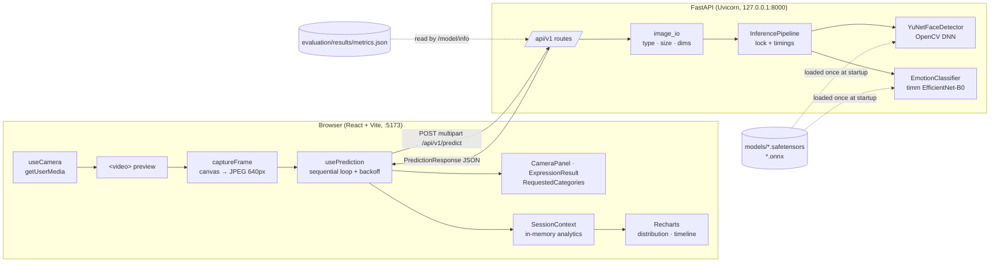

# Architecture

EmoVisionAI is two independently runnable processes on one machine:

## Backend (`backend/app`)

| Module | Responsibility |
| --- | --- |
| `main.py` | App factory. The lifespan hook loads models once; on failure the app keeps serving and reports `degraded`. CORS, body-size middleware and error handlers are registered here. |
| `api/v1.py` | Thin route handlers: validation, then delegation to services. No ML code. |
| `core/config.py` | `pydantic-settings` configuration with the `EMOVISION_` env prefix. |
| `core/errors.py` | One error envelope `{success:false,error:{code,message}}`. Exceptions are logged by type and never echoed to clients. |
| `schemas/api.py` | Pydantic response models, the source of truth for the OpenAPI schema and `frontend/src/types/api.ts`. |
| `services/image_io.py` | Content-type allow-list, header-only dimension check (decompression-bomb guard), OpenCV decode. |
| `services/inference.py` | Decode → detect → crop → classify → response. Holds a lock so only one inference runs at a time. Validates model output shape and finiteness. |
| `services/model_info.py` | Static model card plus the evaluation summary, if `evaluate.py` has produced one. |
| `ml/face_detector.py` | YuNet wrapper: downscales large frames, maps boxes back, clips, filters by minimum size, and sorts largest first. |
| `ml/emotion_model.py` | Builds `tf_efficientnet_b0`, loads safetensors weights, applies HSEmotion's exact preprocessing, and runs inference with `torch.inference_mode()` in channels-last layout. |
| `ml/labels.py` | Model labels, plus the mapping to the five requested categories (measured or unsupported). |

### Design decisions

- **REST, not WebSockets.** Measured server time is about 75 ms per frame and the client samples every 700 ms. A request every 0.7 s carries negligible HTTP overhead next to inference, so a socket would add complexity without a measured benefit.
- **No request overlap.** The client schedules the next capture only after the previous response settles. The server additionally serialises inference behind a lock with a 5 s timeout, which returns `503 server_busy`. On CPU, PyTorch already parallelises one forward pass across cores, so concurrent requests would only add contention.
- **Model weights are never unpickled at runtime.** The upstream checkpoint is a pickled `nn.Module`. `scripts/setup_models.py` loads it once with `torch.load(weights_only=True)` and an explicit class allow-list derived by static opcode inspection (`scripts/inspect_checkpoint.py`). It then verifies the architecture layer by layer and re-saves plain tensors as safetensors.
- **No database.** Nothing needs to persist except display preferences, which live in `localStorage`.
- **Dependency injection for testability.** `create_app(settings, pipeline_factory)` lets unit tests inject fake detectors and classifiers, while `tests/test_real_model.py` exercises the real weights.

## Frontend (`frontend/src`)

| Folder | Contents |
| --- | --- |
| `pages/` | Route components: Landing, Studio, Model Lab, Settings, 404. Studio, Model Lab and Settings are lazy-loaded. |
| `components/` | Presentation only, grouped by area: `layout`, `landing`, `studio`, `model`, `common`. |
| `hooks/` | `useCamera` (stream lifecycle), `usePrediction` (sampling loop), `useSessionAnalytics` (pure reducer plus summary), `useApiResource` (fetch, abort, poll). |
| `context/` | `SettingsProvider` (validated, persisted preferences) and `SessionProvider` (in-memory analytics shared across pages). |
| `services/` | `api.ts` (single fetch wrapper with timeouts, abort propagation and typed `ApiError`) and `frameCapture.ts`. |
| `charts/` | Recharts components and the confusion-matrix table. |
| `types/api.ts` | TypeScript mirror of the backend schemas. |

### Data that leaves the browser

Only downscaled JPEG frames, sent to `127.0.0.1:8000`. Frames are processed in memory and discarded. The browser stores nothing except preferences.
